# Legião MC — Sistema de Gestão para Motoclube

> **Estudo de caso.** Código-fonte privado; demonstração disponível mediante solicitação.
> Todas as telas abaixo foram capturadas numa instância **local**, com dados **fictícios** (nomes "Demo/Exemplo/Fictício", registros `[MOCK]`). A marca do clube foi substituída por um marcador neutro ("LOGO").


Sistema web, em produção, que um motoclube usa para administrar o dia a dia: ingresso de novos membros, hierarquia, motocicletas, mensalidade, caixa, rotas, eventos, feedback entre membros e auditoria. Funciona no computador e no celular.

| | |
| --- | --- |
| **Tipo** | aplicação web (SPA) sob medida, para uso interno do clube |
| **Frontend** | React 19 + TypeScript + Vite, publicado na Vercel |
| **Backend** | Supabase: PostgreSQL com Row Level Security, Auth, Storage e `pg_cron` |
| **Período** | 14/10/2026 → 29/10/2026 (71 commits, 25 pull requests mesclados) |
| **Papel** | desenvolvedor único: produto, front, banco, segurança, testes e operação |

---

## O desafio

O clube (um "Front" regional, com hierarquia definida em estatuto) precisava tirar de planilhas e conversas soltas tudo o que envolve a vida da irmandade:

- **Ingresso de novos membros** com dados pessoais, contato de emergência, moto e documentos — dados sensíveis (CPF, telefone, fotos) que exigem cuidado e base para LGPD.
- **Hierarquia do estatuto** refletida no acesso: quem ocupa um cargo do Comando administra; os demais consultam.
- **Mensalidade** com comprovante, validação pela tesouraria e lançamento automático no caixa.
- **Transparência financeira** para os membros, sem expor quem está em atraso.
- **Rotas e eventos** com mapa e convidados.
- Um sistema público na internet (o cadastro é aberto), portanto alvo de abuso: precisava resistir a robôs, cadastros em massa e chamadas diretas à API.

## A solução

Uma SPA em React que conversa diretamente com o Supabase. **Toda regra de acesso mora no banco** (RLS, funções `security definer` e triggers); a interface apenas esconde o que o perfil não pode fazer. Assim, mesmo uma chamada forjada à API é barrada pelo PostgreSQL.

### Funcionalidades por perfil

| Perfil | Quem é | O que vê e faz |
| --- | --- | --- |
| **Visitante** | sem conta | login, cadastro público de ingresso, recuperação de senha e estatuto (PDF) |
| **Solicitante** | conta criada, solicitação ainda não aprovada | só acompanha a própria solicitação e corrige dados quando a administração pede |
| **Membro** | membro ativo vinculado à conta | consulta agenda, membros, mural da hierarquia, garagem, rotas, eventos e o financeiro (somente leitura, com adimplência agregada); edita a própria ficha (foto, contato, endereço) e as motos da própria garagem, com os campos da administração recusados pelo banco; envia o próprio comprovante de mensalidade; dá e recebe feedback anônimo; ativa 2FA |
| **Administrador** | papel `ADMIN` **ou** titular de um cargo do Comando | tudo acima, mais: análise e aprovação de solicitações (a aprovação cria membro, moto, vínculo de conta e copia as fotos), fichas e cargos, concessão/retirada de acesso de administrador (nunca o próprio), validação de comprovantes, lançamentos financeiros, exportação CSV, relatório financeiro em PDF, cadastro de rotas e eventos com mudança de status direto na página, auditoria, feedbacks recebidos e enviados por membro e moderação do feedback |

**Hierarquia implementada** (tabela de cargos): Comando — Diretor, Sgt. de Armas, Disciplina, Secretário, Tesoureiro (um titular ativo por cargo; o titular é administrador pelo cargo) › Full Patch — Escudado › PP — Próspero (cargo de entrada).

Outros destaques:
- **Cadastro com fotos de celular**: HEIC/HEIF de iPhone e Android convertidos e comprimidos no navegador antes do envio (fotos de até 25 MB, normalmente reduzidas a menos de 300 KB); máscaras e validação de CPF (dígito verificador) e telefone.
- **Feedback anônimo** entre membros: resultados só aparecem a partir de 3 avaliadores; comentários podem ser contestados e moderados.
- **Financeiro analítico**: saldo em caixa, período comparado ao anterior, evolução de 12 meses em gráficos SVG próprios, categorias e adimplência.
- **Mapa** com Leaflet/OpenStreetMap e busca de endereço pelo Nominatim (respeitando o limite de 1 requisição/s). Rotas traçadas pelas estradas (OSRM), com distância e duração preenchidas no formulário e atalhos para Google Maps e Waze.

## Arquitetura

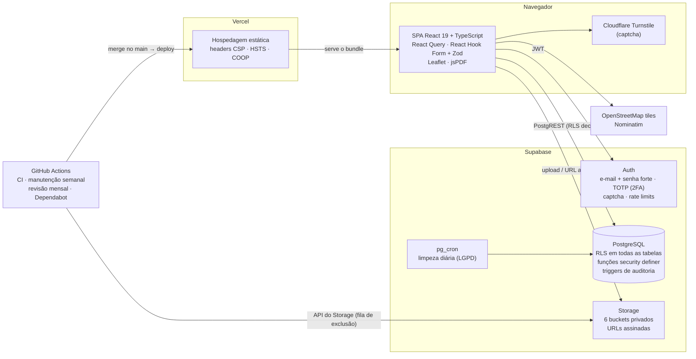

- Acesso a dados só por uma camada de *services* por domínio, consumida por *hooks* do React Query; listas grandes usam paginação explícita porque a API devolve no máximo 200 linhas por requisição.
- Validação em dois lugares: Zod no formulário (experiência) e constraints/triggers/RLS no banco (segurança de fato).
- Migrations versionadas (33) aplicadas em ordem; cada PR descreve a ordem de publicação entre migration e front.

### Modelo de dados (visão geral)

26 tabelas no schema `public`, todas com RLS habilitado. Abaixo, as principais e seus relacionamentos (sem colunas):

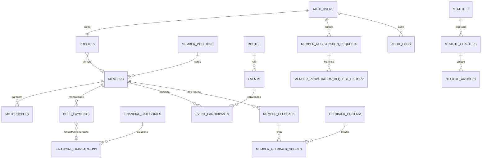

Tabelas de configuração: `dues_settings` (valor e vencimento), `security_settings` (exigência de 2FA), `registration_limits` (freio de cadastros), `storage_cleanup_queue` (fila de exclusão de arquivos).

## Segurança em profundidade

| Camada | O que foi feito |
| --- | --- |
| **Autorização no banco** | RLS em 26/26 tabelas; 55 policies no schema `public` e 31 no Storage; funções auxiliares (`is_admin`, `has_club_access`, `current_member_id`) como `security definer` com `search_path` fixo e permissões revogadas de `anon`/`public` |
| **Cadastro público blindado** | Turnstile no cadastro, login e recuperação de senha; o visitante só grava a própria solicitação e só envia os anexos declarados nela; freio de 30 solicitações/hora no banco; limites de tamanho de texto; CPF validado pelo dígito |
| **Contas** | senha mínima de 10 caracteres com maiúscula, minúscula e número; **2FA TOTP** com aplicativo autenticador — quando exigido, poderes de administrador só valem numa sessão `aal2`; **logout após 30 minutos sem uso** |
| **Navegador** | Content-Security-Policy restritiva, HSTS com preload, COOP, `X-Frame-Options: DENY`, `nosniff`, `Referrer-Policy`, `Permissions-Policy` |
| **Dados pessoais (LGPD)** | buckets privados com URLs assinadas temporárias; rotina diária (`pg_cron`) cancela cadastros não confirmados em 7 dias e libera anexos de solicitações encerradas há 90 dias para exclusão; a adimplência mostrada aos membros não identifica ninguém |
| **Rastreabilidade** | triggers de auditoria em membros, motos, perfis (inclusive troca de papel), financeiro, rotas, eventos, participantes e solicitações |
| **Cadeia de entrega** | `npm audit` (produção, nível alto), `supabase db lint` (Security Advisor, falha em *warning*), **gitleaks** no histórico e E2E sob o CSP de produção a cada PR |
| **Operação** | plano de reação a incidentes documentado (tráfego anormal, enxurrada de cadastros, conta comprometida, chave vazada) e *issue* automática com checklist de segurança todo mês |

**Evidência — headers servidos em produção** (`curl -sI` na página inicial, sem autenticação, em 30/10/2026; o identificador do projeto Supabase foi omitido):

```text
HTTP/2 200
content-security-policy: default-src 'self'; script-src 'self' 'wasm-unsafe-eval' https://challenges.cloudflare.com; worker-src 'self' blob:; frame-src https://challenges.cloudflare.com; style-src 'self' 'unsafe-inline' https://fonts.googleapis.com; font-src 'self' https://fonts.gstatic.com; img-src 'self' data: blob: https://*.tile.openstreetmap.org https://<projeto>.supabase.co; connect-src 'self' https://<projeto>.supabase.co https://nominatim.openstreetmap.org https://router.project-osrm.org; object-src 'none'; base-uri 'self'; form-action 'self'; frame-ancestors 'none'; upgrade-insecure-requests
cross-origin-opener-policy: same-origin
permissions-policy: camera=(), microphone=(), geolocation=(), payment=()
referrer-policy: strict-origin-when-cross-origin
strict-transport-security: max-age=63072000; includeSubDomains; preload
x-content-type-options: nosniff
x-frame-options: DENY
```

## Qualidade

- **164 testes unitários** (Vitest, 24 arquivos, todos passando): regras de mensalidade, finanças e relatório, análise financeira, máscaras e CPF, política de senha, compressão de imagens/HEIC, paginação, geocodificação, schemas de formulário e autenticação.
- **111 execuções E2E** (Playwright, 11 arquivos; 88 no desktop + 23 num celular emulado) contra um Supabase local com confirmação de e-mail, captcha e limite de 200 linhas, como produção. Cobrem cadastro com anexos e aprovação, navegação somente leitura do membro, edição da própria ficha e da própria garagem (inclusive recusas pela API), autenticação, ciclo de 2FA e logout por inatividade, mensalidade, CRUD administrativo, financeiro (inclusive período com 1050 lançamentos) e **ataques diretos à API** (Auth sem captcha, gravação anônima, solicitação forjada, anexos não declarados, freio por hora, CPF inválido, retenção). A suíte se recusa a rodar contra um Supabase que não seja local, e um modo dedicado reprova qualquer recurso bloqueado pelo CSP.
- **CI (GitHub Actions)** em todo PR e push no `main`, com 4 jobs:
  1. Dependências, lint, testes e build (`npm audit`, ESLint, Vitest, TypeScript strict + build);
  2. Migrations e lint do banco (todas as migrations num banco novo + `supabase db lint`);
  3. Segredos no repositório (gitleaks no histórico);
  4. Ponta a ponta sob o CSP de produção (somente em PRs).
- **Dependabot** semanal para npm e GitHub Actions (minor/patch agrupados; majors individuais).
- **Fluxo por PR**: branch → PR com checklist de segurança e seção "Para publicar" → CI verde → merge → deploy automático na Vercel. **33 PRs mesclados** (28 de funcionalidade/correção/documentação e 5 do Dependabot).
- **Rotinas agendadas**: limpeza diária no banco, manutenção semanal do Storage e revisão mensal de segurança.

## Stack

| Área | Tecnologias (versões declaradas no `package.json`) |
| --- | --- |
| Interface | React ^19.3.1, React Router ^7.9.3, TypeScript ~5.9.2, Vite ^7.1.7, lucide-react ^0.468.0 |
| Dados e formulários | @supabase/supabase-js ^2.118.0, @tanstack/react-query ^5.104.5, react-hook-form ^7.91.0, zod ^4.6.5 |
| Mapas e documentos | leaflet ^1.9.4, jspdf ^4.2.1 + jspdf-autotable ^5.0.9, heic-to 1.6.6 |
| Testes | Vitest ^5.0.5, Testing Library, jsdom ^30.1.3, Playwright ^1.64.1 |
| Qualidade | ESLint ^9.36.0 + typescript-eslint ^8.72.0 |
| Backend | Supabase (PostgreSQL, Auth, Storage, `pg_cron`), Supabase CLI 2.120.0 no CI |
| Infra | Vercel, GitHub Actions (Node 22), Cloudflare Turnstile, OpenStreetMap/Nominatim |

## Linha do tempo

| Data | Marco |
| --- | --- |
| 14/10/2026 | primeiro commit: base do sistema (auth, membros, motos, financeiro, rotas, eventos, auditoria) |
| 20/10/2026 | fluxo de ingresso de membros, estatuto e hierarquia |
| 22–23/10/2026 | PRs #1 a #4: mensalidade, hierarquia do Front, mural, feedback, relatório financeiro em PDF; primeiro deploy do `main` registrado pela integração Vercel (23/10) |
| 28/10/2026 | PRs mesclados entre #5 e #25: HEIC, financeiro analítico, **segurança em 5 fases** (headers/CSP, captcha e cadastro blindado, senha + 2FA + inatividade, paginação, CI/Dependabot), guia do usuário |
| 29/10/2026 | PRs mesclados #26 a #29: confirmação de cadastro por código, ajustes de sessão e de navegação no celular |

**71 commits** (46 de código + 25 merges) em 16 dias.

## Meu papel

Concepção, desenvolvimento e operação de ponta a ponta, como desenvolvedor único:
levantamento das regras do clube e do estatuto, modelagem do banco e das policies de RLS, frontend responsivo, estratégia de testes (unitários e E2E, incluindo testes de ataque à API), pipeline de CI, configuração de produção (Supabase, Vercel, SMTP, Turnstile), documentação técnica, guia do usuário e plano de reação a incidentes.

O desenvolvimento usou um assistente de IA (Claude) como par de programação: 51 dos 91 commits registram coautoria. Decisões de produto, de arquitetura e de segurança, revisão e publicação ficaram comigo.

## Resultados

- Em produção desde outubro de 2026 (primeiro deploy do `main` registrado pela Vercel em 23/10/2026), com deploy automático a cada merge.
- Ingresso, mensalidade, caixa, agenda e auditoria do clube num só sistema, acessível no celular.
- Postura de segurança verificável: headers de produção acima, RLS em todas as tabelas e testes automatizados de ataque à API.

## Galeria

Instância local, dados fictícios, marca substituída por "LOGO". Desktop 1440×900; celular 390×844.

| | |
| --- | --- |
| 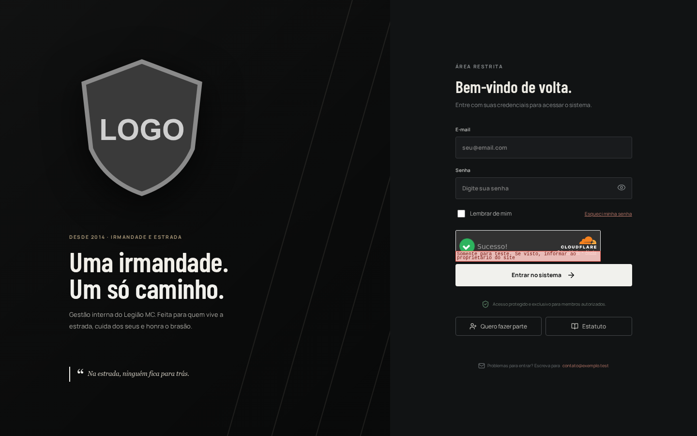 **Login** com captcha (widget de teste da Cloudflare) | 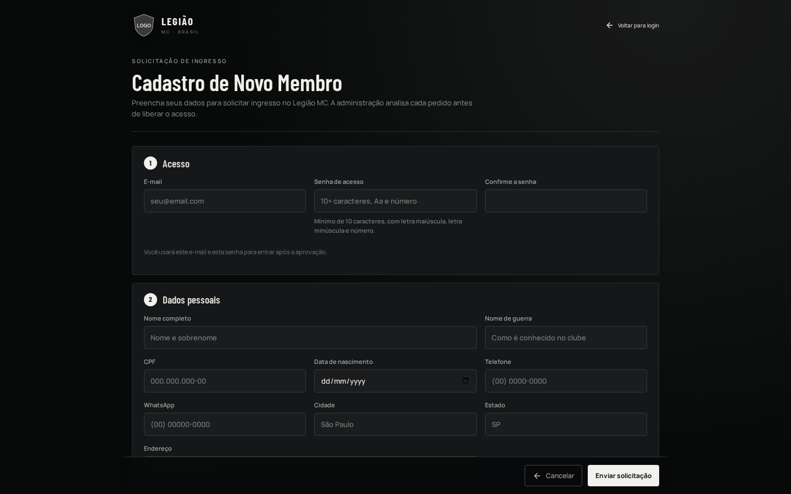 **Cadastro público** de ingresso |
| 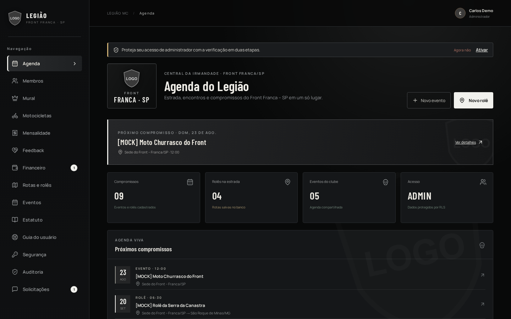 **Agenda** (administrador), com o aviso de 2FA | 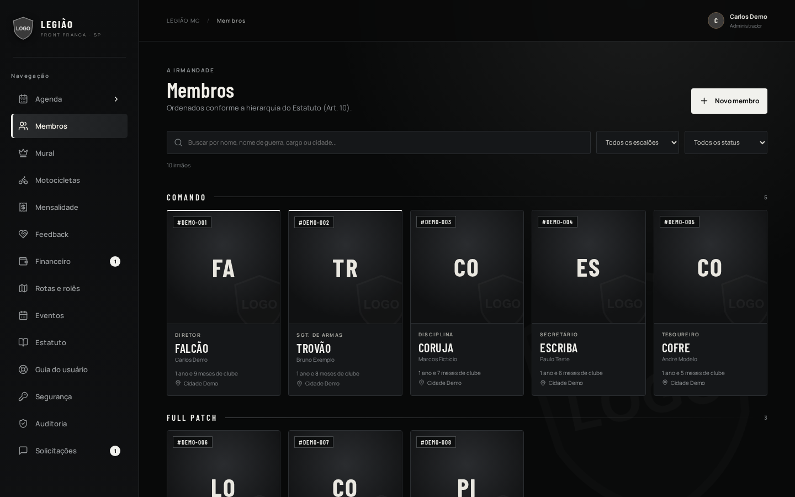 **Membros** ordenados pela hierarquia |
|  **Mural da hierarquia** | 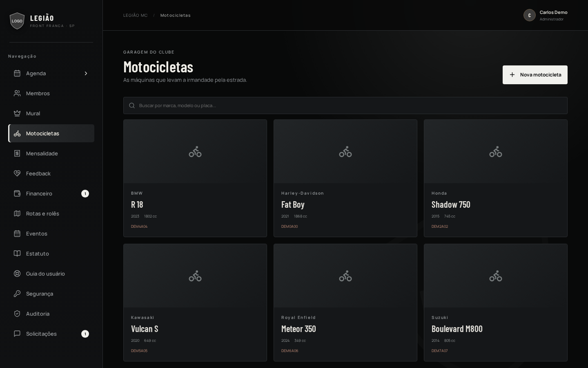 **Garagem do clube** |
| 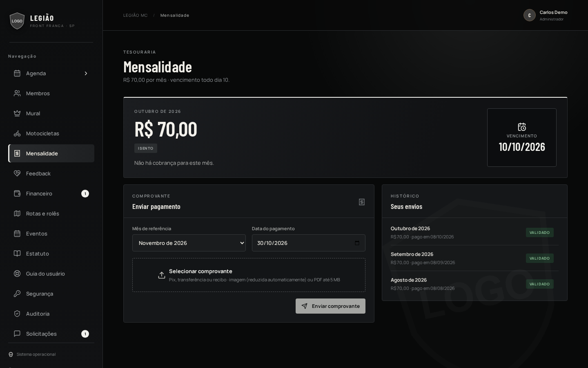 **Mensalidade**: envio de comprovante e histórico | 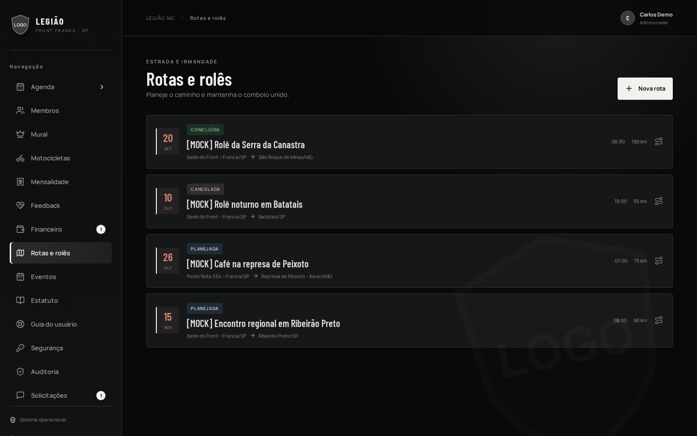 **Rotas e rolês** |
| 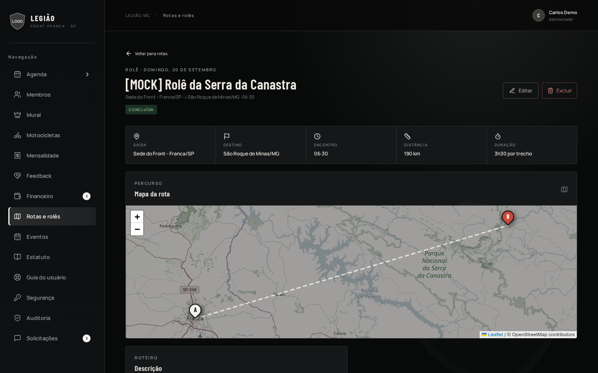 **Rota no mapa** (Leaflet/OpenStreetMap) | 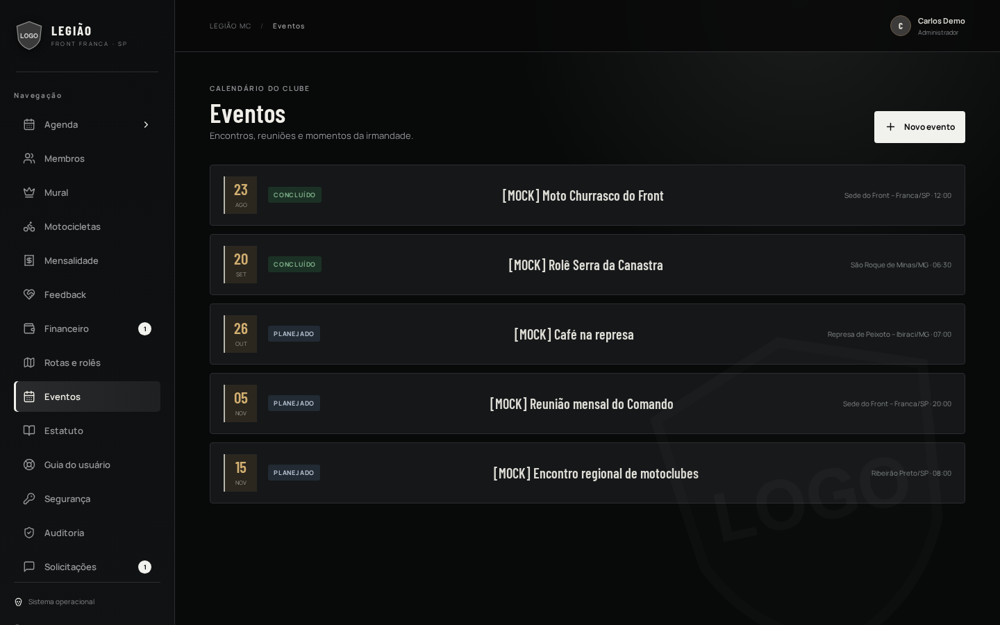 **Eventos** |
| 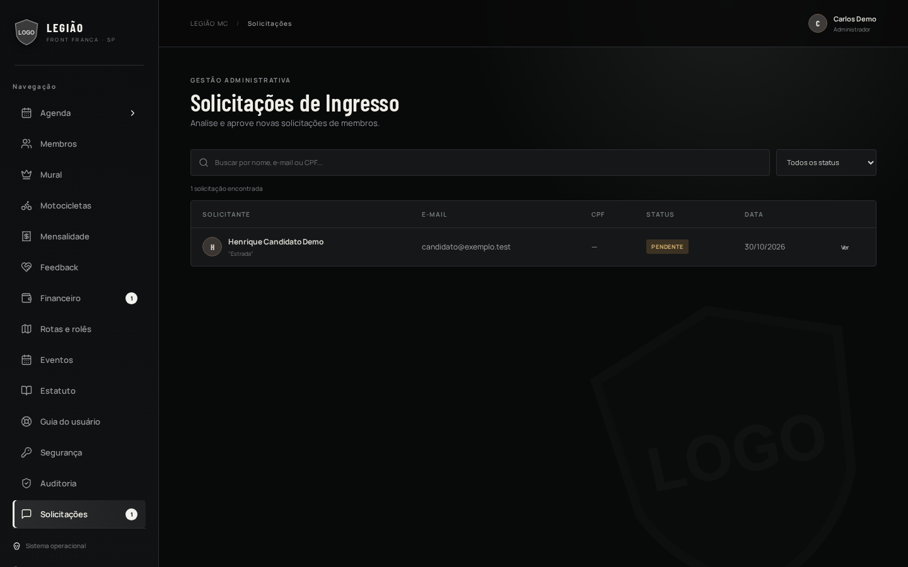 **Solicitações de ingresso** | 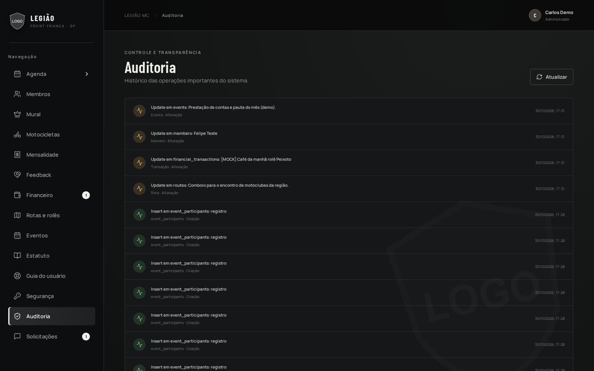 **Auditoria** |
| 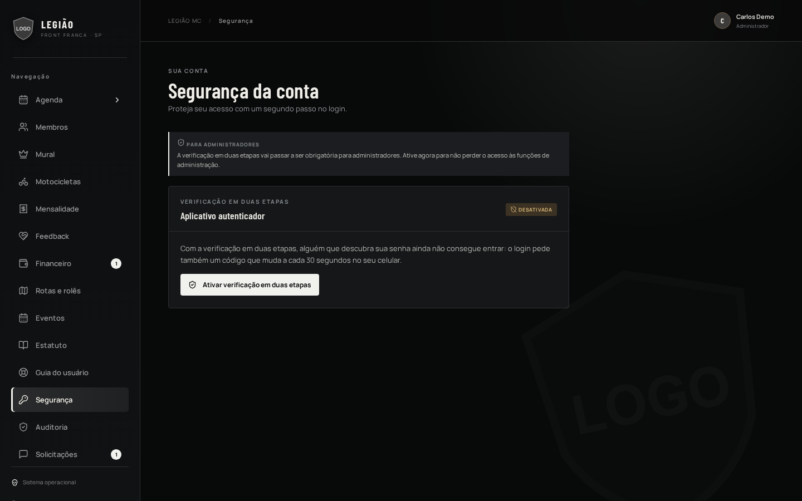 **Segurança da conta** (2FA TOTP) | 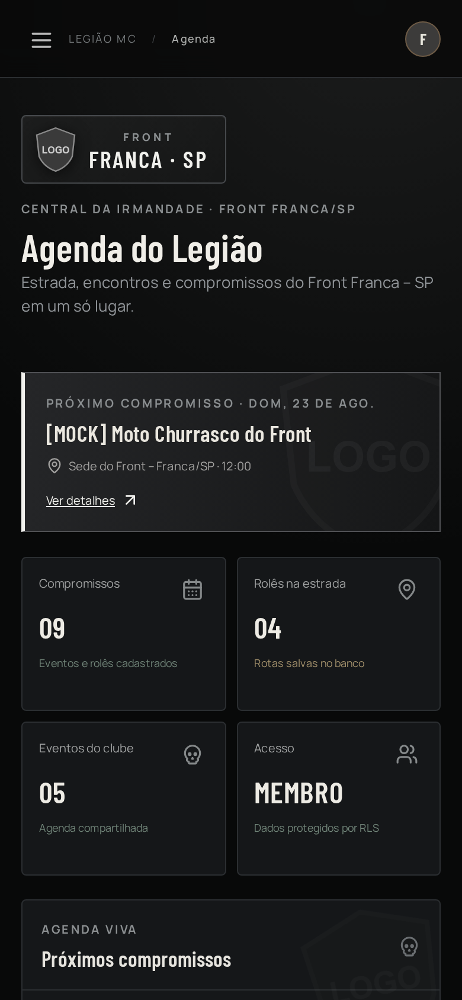 **Agenda do membro** no celular |

**Financeiro (administrador, página inteira)** — controle de mensalidades, análise do período, evolução de 12 meses, categorias, adimplência e lançamentos:

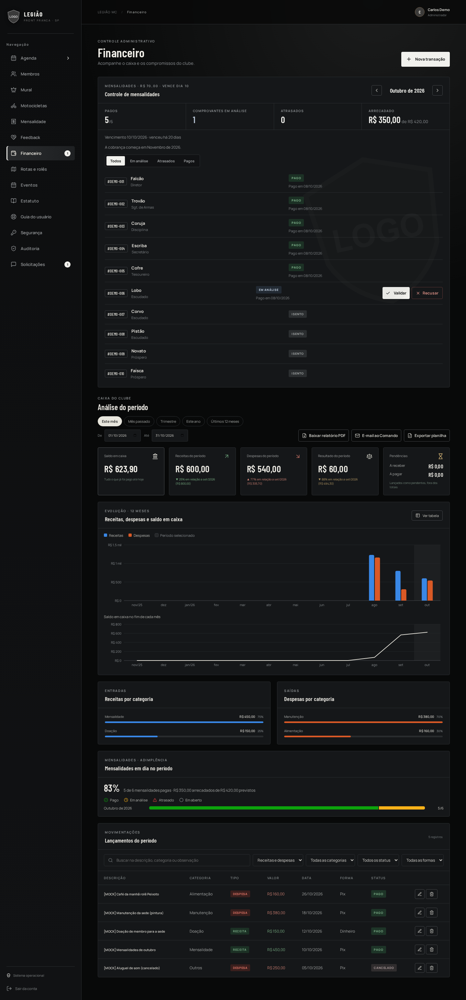

**Financeiro do membro (somente leitura), no celular:**

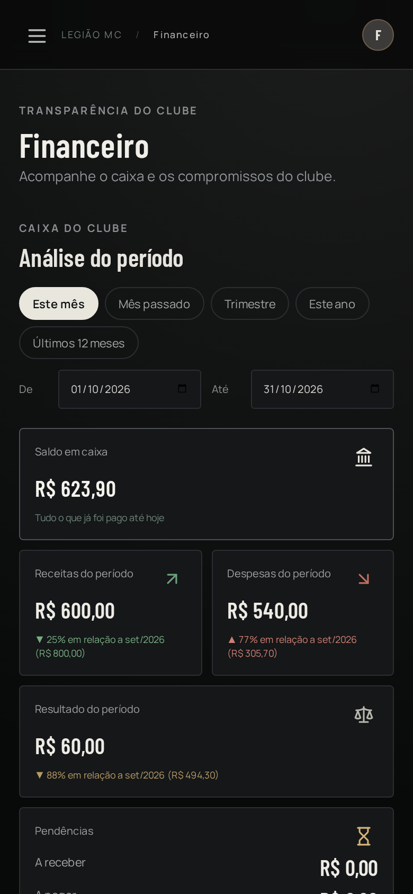

---

**Código-fonte privado; demonstração disponível mediante solicitação.**
Christian Mendes · [github.com/dev-christianmendes](https://github.com/dev-christianmendes)
